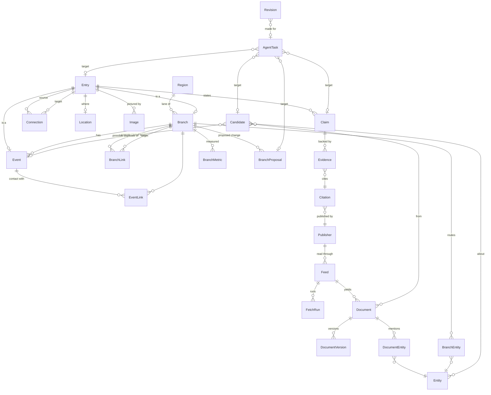

# The data model

30 tables in seven apps (27 models and 3 many-to-many join tables), plus
Django's own. **Canonical** tables (every one in `timeline` and `evidence`)
accept writes only inside `revisions.revising()`, and each changed row leaves
a Revision (ADR 0006). Everything else is working state. Every enum is a
check constraint; the field-level detail is in each model's `help_text`
(visible in the admin).

## How the pieces connect

The flow: **feeds** are fetched by deterministic jobs into **documents**;
their **entities** (Wikidata) route them through **branch entities** to
branches and become **candidates**, matched against existing events by trigram
similarity; a candidate becomes a `write_event` **task**; an agent claims it,
writes the **event** and its **claims** and **evidence** through the services
(leaving **revisions** linked to the task); `publish` writes the published
entries to a **release** snapshot, and the site is built from it.

## timeline (canonical)

| Table | What it's for |
|---|---|
| `Region` | The page's lane groups (cosmos, life, humans, global, faiths, culture, mideast, europe, africa, southasia, eastasia, americas, oceania), with their names and order. |
| `Entry` | Anything with an id on the timeline. Holds what branches and events share: `slug` (the legacy `id`, kebab-case, unique across both kinds), `kind`, `status` (draft → review → published, or retracted), `text`, `why` (TL.enrich's "why it matters"; blank = none), and `sort_key` (the snapshot order, which the page uses to break ties: a fractional index assigned once, so inserting or removing an entry moves no other; ADR 0008). Claims, locations, images and connections point here. |
| `Branch` | A society, polity, lineage, faith, idea or era (multi-table child of Entry): `name`, `region`, `start`/`end` as calendar years (double precision; negative = BCE / years ago; `end` null = continues), `start_when`/`end_when` as written, and derived `*_precision` (billion years … day), `*_approximate` and exact `start_date`/`end_date` for CE days. `origin_note` is TL.origin's note (null = no origin). |
| `Event` | A moment or span on a branch: `branch`, `title`, `y`/`end`, `when`, `imp` (1 landmark, 2 notable, 3 detail), and the same derived date fields. |
| `BranchLink` | A branch's `parent` (split from, grew out of) or `into` (became, merged into) link, in list order. An origin link is a parent link with `origin_position`, `how` (independence, split, successor, merger, conquest, peoples, context, ideas, reaction) and a note. |
| `EventLink` | An event's contact, blending or conflict with another branch (the dashed connector, legacy `link`). The page draws one; the table allows several. |
| `Connection` | TL.enrich's sourced link from one entry to another, with a ≤ 90-char note. |
| `Location` | TL.geo: `scope` (place, region, global, cosmic), lat/lon, `radius_km` (`r`), label, `src` (the page whose coordinates are the place), `scale` for cosmic entries. |
| `PaleoPin` | Where a present-day coordinate lay at a PaleoDEM slice's age (PALEOMAP via the GPlates Web Service), imported from `globe-assets.json`. The site build still reads that file; these rows make the positions queryable. |
| `Image` | TL.image: a public-domain or CC0 Commons image (`src` under `site/images/`, size, title, credit, license, Commons page). |

## evidence (canonical)

| Table | What it's for |
|---|---|
| `Publisher` | A cited site by domain (Wikipedia editions are one): reliability `tier` 1–4 (empty = unrated), license, `fetch_policy` (allowed, browser_only, forbidden) and access notes. Starting ratings for known sites: `evidence/publishers.py`. |
| `Citation` | One cited URL (https only, never openstax.org), shared by every claim citing it: canonical URL, title, kind, and the last check (when, HTTP status, content hash, archive URL). |
| `Claim` | An atomic statement about an entry: `field` (as_written, date, title, text, location, origin, why, connection, link, number, actor) and `key`, its `value` as JSON, the computed `status` and `confidence`, and when to re-read it (`recheck_after`, `recheck_reason`, `recheck_requested_at`). Legacy content has one `as_written` claim per entry and `why` / `origin` claims where they exist (the record claims); the splitter adds date, location, number and actor claims as their children (`parent`). See `docs/fact-checking.md`. |
| `Evidence` | A claim ↔ citation pair in cite order: `stance`, an excerpt of ≤ 25 words, `checked_at`, `checked_by` (agent / human / job), `method` (legacy, fetch_match, agent_read, browser_read, human), the title and kind as the entry cites it, what the source says when it differs (`found_value`), and the page's hash when checked (`content_hash`). Only supporting evidence is published. |

## revisions

| Table | What it's for |
|---|---|
| `Revision` | One per changed canonical row, written by the trigger: when, transaction id, actor and its kind, table and primary key, action, the row before and after (JSON), the changed columns, the reason and the task. Append-only. |

## ingest

| Table | What it's for |
|---|---|
| `Feed` | Something a job reads on a schedule: publisher, URL, kind (api, rss, sitemap, html), interval, enabled, kind-specific config, and conditional-request state (ETag, Last-Modified, cursor). |
| `FetchRun` | One run of a feed: timings, status, counts (fetched, new, changed, unchanged, errors), error. |
| `Document` | A fetched page or record by canonical URL (latest version): fetch time and status, sha256 content hash (raw bytes in `var/raw/<hash[:2]>/<hash>`), title, published date, language, license, extracted text, metadata JSON (wikilinks, categories, og: tags), `version` and `changed_at`. |
| `DocumentVersion` | Every distinct content hash a document has had, so changed pages are detectable and old versions findable. |
| `Entity` | A Wikidata item (QID unique): label, kind (person, place, polity, org, work, event, concept), coordinates, aliases. |
| `DocumentEntity` | Which entities a document mentions, with salience and mention count. |
| `BranchEntity` | Which entities belong to a branch, with role and weight: the deterministic routing of new material to branches. |
| `Candidate` | A proposed timeline item from one or more documents: kind (new_event, update, new_branch_signal), title, date guess and precision, entities, branch scores, possible duplicate event and its trigram similarity, cluster key, priority, status (queued, claimed, accepted, rejected, merged), and the entry it became. |

## work

| Table | What it's for |
|---|---|
| `AgentTask` | The queue: kind (write_event, verify_claim, enrich, audit, review_branch_proposal, recheck_citation), target (entry, claim, candidate, proposal or a free reference), payload, priority, status, `dedupe_key` (one open task per kind and key), the lease (`claimed_by`, `claimed_at`, `lease_until`, attempts of `max_attempts`), result, error, and who created it. |

## governance

| Table | What it's for |
|---|---|
| `BranchMetric` | `manage.py branches metrics`'s snapshot of a branch's shape (events, span, windows, density against peers, gaps, phases, links, geographic clusters, structure; JSON, see `docs/branch-rules.md`), stored when it changes, with the metrics version. |
| `BranchProposal` | A rule's proposed split, merge, new branch or ending (`rule_id` such as `SPLIT-PLACE-v1`), with what it saw (`evidence`), the change (`payload`: its key, strength, operations and the fields an agent must write), and the decision (status proposed → applied / rejected / withdrawn, by whom, when, note). `branches apply` runs the operations through the timeline's services and records the transaction in `payload.applied`; `branches revert` undoes it from the Revisions. |

## publish

| Table | What it's for |
|---|---|
| `Release` | One `manage.py publish`: version (`YYYY.MM.DD.N`), who, the content's sha256, the snapshot path under `var/`, counts, and the last Revision it includes. |

## The snapshot

`var/releases/<version>/content.json` is `{"branches": […], "events": […]}` in
the canonical shape of `site/canonical.mjs` (ADR 0007), exactly what the page
inlines apart from its build date; `manifest.json` beside it has the version,
hash and counts. The mapping from rows:

| Snapshot | From |
|---|---|
| `id`, `text`, `why` | `Entry.slug`, `text`, `why` (why, connections and whyCites only when `why` is set) |
| branch `name`, `region`, `start`, `end`, `startWhen`, `endWhen` | `Branch` (whole numbers written as ints) |
| `parents`, `into` | `BranchLink` by relation, in `position` order, published targets only |
| `origin` | `Branch.origin_note`, origin links in `origin_position` order, and the `origin` claim's citations |
| event `branch`, `y`, `end`, `when`, `title`, `imp` | `Event` |
| `link` | the first `EventLink` |
| `cites`, `whyCites` | the `as_written` / `why` claim's supporting evidence in order: `cited_title`, the citation's URL, `cited_kind` |
| `geo` | `Location` (`radius_km` → `r`) |
| `images` | `Image` in order (`width`/`height` → `w`/`h`) |
| `connections` | `Connection` in order |
