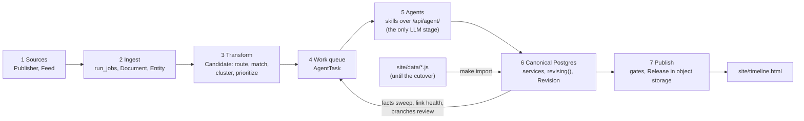

The platform turns outside material (news feeds, Wikipedia pages, open archives) into a cited timeline that
anyone can read as a single static web page. Scheduled programs do the mechanical work of collecting and sorting;
Claude agents do the work that needs judgment, such as writing an event or checking a source; a database keeps
every fact, the evidence behind it and a record of every change. Readers never touch that database: they get a
frozen copy of it, published as files.

## The seven stages

| Stage | What happens | Where | Chapter |
|---|---|---|---|
| 1. Sources | Who we read, how often, and under which terms | `ingest/seed.py`, `ingest/policy.py`, `evidence/publishers.py` | [Sources and terms](sources-and-terms.md) |
| 2. Ingest | Fetch, store by content hash, extract text, resolve Wikidata entities | `ingest/jobs.py`, `ingest/http.py`, `ingest/store.py`, `ingest/wikidata.py`, `infra/storage.py` | [Ingestion](ingestion.md) |
| 3. Transform | Turn items into candidates: route to branches, find duplicates, cluster, score | `ingest/routing.py`, `ingest/process.py` | [Ingestion](ingestion.md) |
| 4. Work queue | Tasks with everything an agent needs, leased one agent at a time | `work/` | [Work queue and agents](work-queue-and-agents.md) |
| 5. Agents | Claude sessions drain the queue through the agent API, which writes through the service layer | `.claude/skills/`, `agentapi/` | [Work queue and agents](work-queue-and-agents.md) |
| 6. Canonical Postgres and validation | The content, its evidence and its audit log; the daily and weekly checks that feed work back | `timeline/`, `evidence/`, `revisions/`, `governance/` | [Content model](content-model.md), [Revisions](revisions.md), [Evidence and fact-checking](evidence-and-fact-checking.md), [Branch governance](branch-governance.md) |
| 7. Publish | Release gates, then a versioned, immutable release in object storage, and the page built from it | `publish/`, `infra/storage.py`, `site/build.mjs` | [Publishing](publishing.md) |

How to run, schedule and repair all of this is in [Operations](operations.md); terms are in the
[glossary](glossary.md). Every table is in [the data model](../data-model.md).

## Stage 1: sources

A **Publisher** (in `evidence`, canonical) is a site we cite, by domain: a reliability `tier` from 1 to 4, a
license, a `fetch_policy` (`allowed`, `browser_only` or `forbidden`) and access notes that record its terms. A
**Feed** (in `ingest`) is something a job reads on a schedule: a URL, a publisher, an `interval_minutes`, an
`enabled` switch and a `config` whose `job` key names the job that reads it. The `seed_sources` job creates both
from `ingest/seed.py` (`PUBLISHERS`, `FEEDS`), and writes the terms verdicts (`VERDICTS`) into the publishers'
access notes once. After that it never overwrites a rating, a policy or a feed's `enabled` flag.

Sources come in two shapes.

| Shape | What it does | Sources on main |
|---|---|---|
| Feeds | Push new items into ingest | Wikipedia Current events portal (`portal`), "<Year> in <Country>" pages (`year_pages`), WHO Disease Outbreak News (`who_don`), Federal Register presidential documents (`federal_register`), The Gazette's state notices (`gazette`), Nobel Prize announcements (`nobel`) |
| Lookup adapters | Answer "find support for this claim" when a job asks | `ingest/lookup.py` `ADAPTERS`, in this order: Nobel, World Bank, Office of the Historian, Chronicling America, Library of Congress, Smithsonian, Europeana, OpenAlex, Crossref |

Two more feeds keep reference data fresh rather than bringing news: `refresh_entities` re-reads Wikidata facts, and
`historian_sync` copies the Office of the Historian's Milestones (public-domain TEI on GitHub) into Documents for
the Historian lookup adapter. It makes no candidates. The `rss` job has three seeded feeds (UN News, UN press
releases, UNESCO World Heritage), all disabled because their publishers are `browser_only`.

Each lookup adapter also has a Feed row (`config["job"] = "lookup"`). No job of that name exists: the row is only
the adapter's on/off switch. Smithsonian and Europeana stay off until their keys are in `.env`.

Some publishers are citation-only: we may cite their pages, but no job ever fetches them. `ingest/policy.py`
`NEVER_FETCH` lists Britannica, the Guardian, the BBC, NPR, Al Jazeera, AP and Olympedia, plus OpenStax, which is
never cited either. Publishers whose `fetch_policy` is `browser_only` (the UN, UNESCO, nobelprize.org and others)
are refused the same way. Agents read these in a browser. The decision and every verdict are in
[ADR 0013](../adr/0013-source-policy.md).

## Stage 2: ingest

`manage.py run_jobs` is the scheduler's one entry point. It runs every job that is due, once, in the order
`ingest/job_defs.py` registers them, under a Postgres advisory lock, so a second runner exits at once. The
`worker` process runs the same thing in a loop (`run_jobs --loop`, every `WORKER_TICK_SECONDS`). Each run of a job
(or of a job on one feed) is a **FetchRun** with its status, counts and error; a failing job is recorded and the
next one runs, and one that fails three runs in a row sends an alert (`infra/alerts.py`). How runs are scheduled
and watched is in [Operations](operations.md).

Every request goes through one client, `ingest.http.Fetcher`. Before a request leaves the machine it checks
`NEVER_FETCH`, the publisher's `fetch_policy` and robots.txt. It sends one request at a time with a per-host
delay, backs off on 429 and 503, and sends stored ETag and Last-Modified values so an unchanged page comes back
as 304.

What comes back is a **Document**, keyed by its canonical URL. The raw bytes go to the `raw` object store at
`raw/<hash[:2]>/<hash>` (their sha256), through `infra/storage.py`, never into the database or git. A different hash bumps the document's `version` and adds a
**DocumentVersion**. Extraction keeps what the source policy allows: wikitext for Wikipedia, and a short lead for
news, never the full article.

Entities come next. Wikilinks in Wikipedia text resolve exactly, title to Wikidata QID (`WikiTitle`), into
**Entity** rows that carry what routing needs: kind, coordinates, country (P17), located in (P131) and
citizenship (P27). News items have no wikilinks, so their names are matched against known entities instead.

## Stage 3: transform

Each item becomes a **Candidate**: a proposed event with a date guess, its entities and its documents. The
`process` job then works through the open candidates.

- **Routing.** `BranchEntity` maps Wikidata items to branches. A candidate's entities score each branch: an
  entity that is one of the branch's own (its country, faith or organization) counts most, a place in that
  country less, a person who is a citizen of it least. Only branches whose span covers the date score.
- **Duplicates.** Each candidate is compared with existing events by pg_trgm title similarity, inside a date
  window that depends on the event's precision.
- **Clusters.** Items about one story are grouped: portal items by their story's article within a month; news
  and year-page items by a URL the portal cites, or else by shared entities within a few days.
- **Priority.** A documented score from 0 to 100 per cluster (sources, tiers, branches touched, category,
  recency, pageviews, minus a duplicate penalty). A cluster over the threshold becomes a `write_event` task.
- **New-branch signals.** An entity that keeps appearing with no branch to route to becomes a
  `new_branch_signal` candidate.

The formulas and thresholds are in [Ingestion](ingestion.md) and
[ADR 0012](../adr/0012-ingestion.md).

## Stage 4: the work queue

An **AgentTask** is one piece of judgment work, with a `payload` that holds everything the agent needs: the
story's items, sources, entities with coordinates, suggested branches, possible duplicates and suggested sources.

| Kind | Queued by |
|---|---|
| `write_event` | `process`, for a cluster over the priority threshold (`enrich_tasks` then adds lookup hits to its payload) |
| `verify_claim` | `facts_sweep` (conflicts, dead or changed pages, due rechecks, Wikipedia-only events) and `second_source` |
| `map_branch_entities` | `seed_branch_entities`, for a branch with no exact Wikidata match |
| `review_branch_proposal` | `branches_review`, one per proposal |
| `audit` | `branches_review`, for a branch much thinner than its peers |

`work/models.py` also defines `enrich` and `recheck_citation`; no job queues them on main.

A claim on a task is a lease: `POST /api/agent/tasks/claim` (or the owner's `manage.py tasks next --claim`) takes
the best task under `SELECT … FOR UPDATE SKIP LOCKED`, so agents working at once never get the same one. The lease lasts
`config/settings.py` `TASK_LEASE_MINUTES` (30 by default); after that another agent may take the task over. A
`dedupe_key` keeps one open task per kind and key, so re-running a job never doubles the work.

## Stage 5: agents

Agents are Claude sessions, and the only stage that calls a language model. Each skill in `.claude/skills/` drains
one kind of task: `drain-write-events`, `verify-claims` and `verify-stale-claims`, `review-branch-proposals`. A
session claims a task, does the reading, and completes the task with a JSON result. The owner's `manage.py digest`
gives the overview.

Agents work through the agent API under `/api/agent/` (`agentapi/`, served by the `web` process), never the
database ([ADR 0017](../adr/0017-agent-api.md)). An agent holds a token, made by the owner with `manage.py
agent_token create <name> --scope <kind>`, stored only as a hash and scoped to the task kinds it may claim; it
reads the base URL and the token from `HUMANITRIBUTARY_API` and `HUMANITRIBUTARY_API_TOKEN`. The queue endpoints
call `work.queue` unchanged. `complete` checks the result against its kind's JSON Schema (`agentapi/schemas.py`; a
422 lists the problems) and `agentapi/apply.py` applies it through the service layer inside
`revising("agent:<name>", task=task)`, completing the task in the same transaction, so each change links back to
its task and a failure leaves nothing behind. A token is rate-limited (`AGENT_API_RATE_PER_MINUTE`, 120).

What an agent writes lands in review. A new event (`write_event`, `audit`) is created as `review`; `verify_claim`
evidence goes through `record_evidence`, and a corrected text stays in the result (`proposed_text`), never applied;
an accepted branch proposal stores the agent's operations for the owner's `manage.py branches apply`;
`map_branch_entities` writes routing rows. Nothing the API writes is published: the owner publishes an entry under
the publishing rule (`manage.py facts publish`), and only `manage.py publish` makes a release. The CLI (`manage.py
tasks`, `facts record`, `branches apply`) stays for the owner.

Until the cutover, the next `make import` (it runs `import_legacy --retract-missing`) would retract a published
event that exists only in Postgres, so the owner carries an agent's event into `site/data/*.js` when they publish
it.

## Stage 6: canonical Postgres and validation

The `timeline` and `evidence` tables are canonical: what the page says and the evidence for it. They accept
writes only inside `revisions.revising(actor, reason, task)`. A Postgres trigger refuses any other write (ORM,
bulk update, raw SQL) and records every changed row, before and after, as a **Revision** with its actor and task.
The working tables in `ingest`, `work`, `governance` and `publish` are not audited. See
[Revisions](revisions.md) and [ADR 0006](../adr/0006-every-canonical-change-leaves-a-revision.md).

Three scheduled checks read the canonical tables and feed work back into the queue. This is the self-healing loop.

| Job | Interval (`ingest/job_defs.py`) | What it does |
|---|---|---|
| `link_health` | `DAY` | Re-checks cited URLs and records a `LinkCheck` for each |
| `facts_sweep` | `DAY`, right after `link_health` | Splits entries into atomic claims, recomputes each claim's status and confidence, schedules rechecks by claim type and entry age, records date conflicts from candidates, and queues `verify_claim` tasks |
| `branches_review` | `WEEK` | Measures every branch, runs the named rules (SPLIT-PLACE, SPLIT-TIME, MERGE-OVERLAP, END-STALE, NEW-BRANCH, THIN) and turns findings into proposals and tasks, with hysteresis |

The details are in [Evidence and fact-checking](evidence-and-fact-checking.md) and
[Branch governance](branch-governance.md).

## Stage 7: publish

`manage.py publish` (`make publish`) exports every `published` entry as a **release** in the `releases` object
store: `releases/<version>/content.json` (the snapshot), `manifest.json`, the change report (`changes.json` and
`changes.md`: what was added, changed and retracted since the release readers had, by branch) and `timeline.html`
(the page built from the snapshot). It also writes a **Release** row: the version (`YYYY.MM.DD.N`), the sha256 of
the snapshot, the counts and the last Revision included. Nothing under `releases/<version>/` is ever overwritten.
`releases/latest.json` is the one object that moves: a pointer naming the version readers get. If the content hash
matches the newest release, nothing is written (unless `--force`). Same rows, same bytes:
[ADR 0007](../adr/0007-one-snapshot-shape-byte-identical-both-ways.md), amended by
[ADR 0018](../adr/0018-single-source-marker.md) for keys derived at publish time, such as `singleSource` on an
event that rests on one independent witness.

`publish` refuses unless every release gate in `publish/gates.py` passes
([ADR 0019](../adr/0019-processes-and-release-gates.md)): the site's own build accepts the snapshot and builds the
page (build); no published entry has an unflagged contested record claim (contested); the site reads the snapshot
back byte for byte, and equals `var/legacy.json` on every legacy key when `make publish` passes it (roundtrip); and
the change report is in the store before the pointer moves (report). `publish --check` runs the gates and writes
nothing.

`make release-pull` (`manage.py storage pull-release`) mirrors a release into `var/releases/<version>/` and points
`var/releases/latest` at it; `make build-release` pulls, then builds the page, timeline.html in `site/`, from the
mirror. Rolling back is a pointer write: `manage.py publish --rollback <version>` repoints `latest.json` after
checking the snapshot's hash ([Operations](operations.md#restore-a-release)).

Publishing is run by hand. Nothing deploys the page yet; the `releases` bucket is meant to be the CDN's origin.

## The legacy path

Until the cutover, `site/data/*.js` is still where most content is edited. `make import` dumps it
(`node site/build.mjs --dump-json var/legacy.json`) and upserts it into Postgres as `job:import_legacy`,
writing only what changed. The import never overwrites review state: an entry's status, a publisher's rating,
check results, evidence stance. `make roundtrip` proves that the import and the export are exact inverses on
every key the legacy dump has. See
[ADR 0001](../adr/0001-postgres-is-the-truth-the-site-reads-snapshots.md) and [Publishing](publishing.md).

## What is deterministic and what isn't

| Deterministic: same input, same output | Judgment |
|---|---|
| Every job in `ingest/job_defs.py`: fetching, extraction, entity resolution, routing, duplicate matching, clustering, priority, lookup scoring, link health, the fact sweep, branch metrics and rules | Agents: writing an event, deciding whether a page supports a claim, deciding a branch proposal, mapping a branch's entities |
| Claim status and confidence (`evidence/confidence.py`), never typed in | The owner's edits in the admin (`human:<username>`) |
| The snapshot and the page built from it | |

No job calls a language model ([ADR 0003](../adr/0003-deterministic-jobs-and-an-agent-queue.md)). Anything that
needs judgment becomes a task.

## How it is wired

| File | Role |
|---|---|
| `config/settings.py` | `SITE_NAME`; `ENVIRONMENT` (`dev`, or anything else for production safety); `DATABASE_URL` (required); `VAR_DIR` (default `var/`), with `LOG_DIR` and `RELEASES_MIRROR_DIR` under it; the `raw` and `releases` storages (`STORAGE_BACKEND`, the `S3_*` variables); `TASK_LEASE_MINUTES`; `WORKER_TICK_SECONDS`; `ALERT_AFTER_FAILURES`, `ALERT_EMAILS` and the mail settings; `AGENT_API_RATE_PER_MINUTE`; `INGEST_CONTACT` and `INGEST_USER_AGENT`; the two lookup keys. Outside `dev`: TLS to the database, HTTPS redirect, secure cookies, HSTS (`SECURE_HSTS_SECONDS`), logs to stdout at `LOG_LEVEL`, and the local storage backend refused unless `STORAGE_BACKEND=local` is set. `INSTALLED_APPS` lists the apps in dependency order ([ADR 0002](../adr/0002-django-and-apps-by-responsibility.md)). |
| `config/urls.py` | The admin (the owner's review screen), the agent API under `/api/agent/` and `/healthz`. The public page never touches this server. |
| `infra/` | `storage.py` (the one door to object storage), `manage.py storage`, `health.py` (`/healthz`) and `alerts.py`. No models. |
| `ingest/job_defs.py` | Every scheduled job with its interval, in run order: set-up, sources, entities, processing, upkeep. |
| `Makefile` | The commands (`make help`): database and storage, import, publish, build, round trip, tests, processes, jobs, schedule. |
| `docker-compose.yml` | The local services: Postgres 16 on host port 5433, and MinIO (the local S3) on `127.0.0.1:9000`, its console on 9001. |
| `Procfile` | The processes: `release` runs migrations, `web` runs gunicorn (admin, agent API, `/healthz`), `worker` runs `manage.py run_jobs --loop`. `make up` runs `web` and `worker` locally with honcho. |
| `app.json` | Heroku's description of the app: the `heroku/python` buildpack, the formation (`web` 1, `worker` 0, Basic), Postgres Essential-1 (16) and the config vars. Read by review apps and a rebuild from scratch, not by ordinary deploys. |
| `.github/workflows/check.yml` | CI: `make check-pr` on every pull request and push to main, with a Postgres 16 service container and `STORAGE_BACKEND=local`, no secrets. |
| `pyproject.toml` | Python 3.12, Django 6, psycopg 3, httpx, trafilatura, feedparser, dateparser, gunicorn, whitenoise, django-storages and boto3, jsonschema; honcho for development. |

The job order in `ingest/job_defs.py`:

| Group | Jobs |
|---|---|
| Set-up | `seed_sources`, `seed_branch_entities` |
| Sources | `portal`, `year_pages`, `rss`, `who_don`, `federal_register`, `gazette`, `nobel`, `historian_sync` |
| Entities | `refresh_entities`, `pageviews` |
| Processing | `process`, `enrich_tasks` |
| Upkeep | `link_health`, `facts_sweep`, `branches_review`, `second_source` |

## Environments

| | Local | Staging (Heroku `humanitributary-staging`) | Production |
|---|---|---|---|
| Database | Postgres 16 in Docker on 5433 (`make db`) | Heroku Postgres Essential-1, Postgres 16; starts empty | Heroku Postgres (at launch) |
| Raw documents and releases | MinIO in Docker on `127.0.0.1:9000` (`make db` creates the buckets), or `var/storage/<bucket>/` with `STORAGE_BACKEND=local` | The dyno's disk (`STORAGE_BACKEND=local`) until the `S3_*` variables are set | S3 or Cloudflare R2, by the same `S3_*` variables (planned) |
| Processes | `make up`: `web` (gunicorn on 127.0.0.1:8000) and `worker` via honcho | The `Procfile`: `release` (`migrate`), one Basic `web` dyno, the `worker` at 0 | The same `Procfile` (at launch) |
| Scheduled jobs | The worker while `make up` runs, and launchd every 15 minutes if installed (`make schedule-install`); the locks keep them from overlapping | None until object storage exists; then the `worker` dyno | A `worker` dyno, or Heroku Scheduler running `run_jobs` |
| The page | timeline.html in `site/`, built from the mirror in `var/releases/` | Not served | a CDN serving the `releases` bucket (planned) |

The Heroku pipeline `humanitributary` holds staging now and production at launch
([ADR 0020](../adr/0020-heroku-hosting.md)). CI (`.github/workflows/check.yml`) runs the gate with a throwaway Postgres and the
local storage backend; the test suite always swaps both storages for temporary directories (`tests/runner.py`), so
it never reaches MinIO, S3 or the network.

Staging runs the `Procfile` on Heroku with whitenoise for the admin's static files and `DATABASE_URL`,
`SECRET_KEY`, `ALLOWED_HOSTS`, the `S3_*` variables and the mail settings from config vars; how it is deployed is
in [Operations](operations.md#hosted-heroku). A dyno's disk can be thrown away, because nothing that isn't a row lives on it
([ADR 0016](../adr/0016-object-storage.md)). In every environment the database stays out of the page's read path:
the page is built from a release, so a database outage stops editing, never reading.

## Changing it

| Change | What it needs |
|---|---|
| A new stage or app | An ADR; the app in `INSTALLED_APPS` in dependency order; this chapter and its diagram |
| A new job | A function in `ingest/job_defs.py` with `@job(name, interval=…)` in the right group; it must make no LLM calls; a test on recorded fixtures; [Ingestion](ingestion.md) |
| A new source | Its terms read first, its verdict in `ingest/seed.py` and [ADR 0013](../adr/0013-source-policy.md); [Sources and terms](sources-and-terms.md) |
| A new kind of judgment | A new `AgentTask.Kind` (a migration), the job that queues it with a complete payload, a result schema in `agentapi/schemas.py` and its applier in `agentapi/apply.py`, and a skill to drain it |
| A new canonical table | `audit_table()` in its migration (`tests/test_revisions.py` fails until it has one) |
| A new setting | `config/settings.py`, read from the environment, with a line in `.env.example` if a developer must set it |
| A new content field | `site/canonical.mjs`, `publish/content.py` `KEYS` and `site/SCHEMA.md` together ([ADR 0007](../adr/0007-one-snapshot-shape-byte-identical-both-ways.md)); a field derived at publish time also goes in `ADDITIVE` ([ADR 0018](../adr/0018-single-source-marker.md)) |
| A new hosted environment (production) | An app in the `humanitributary` pipeline with its own Postgres, the config vars in [Operations](operations.md#hosted-heroku), `app.json` if the formation or add-ons differ, the CDN in front of the `releases` bucket (with its cache headers, not set yet); update the environments table |
