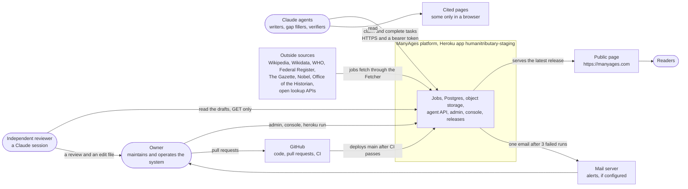
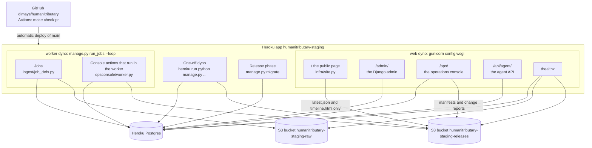
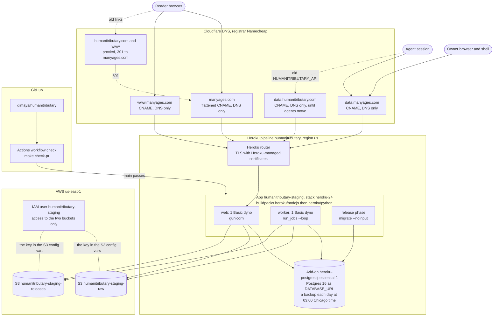
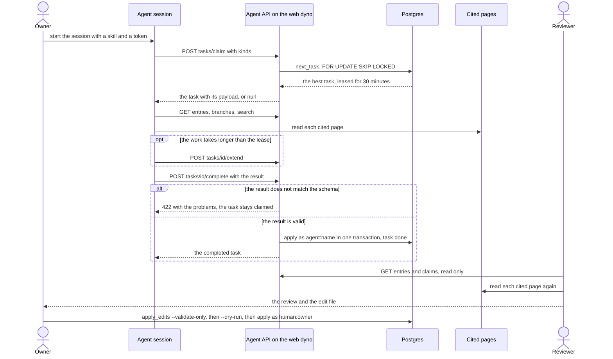
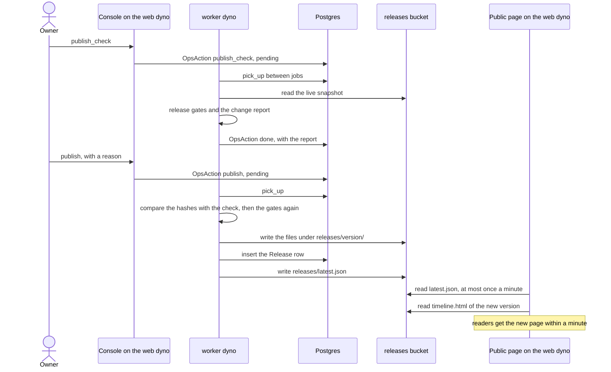
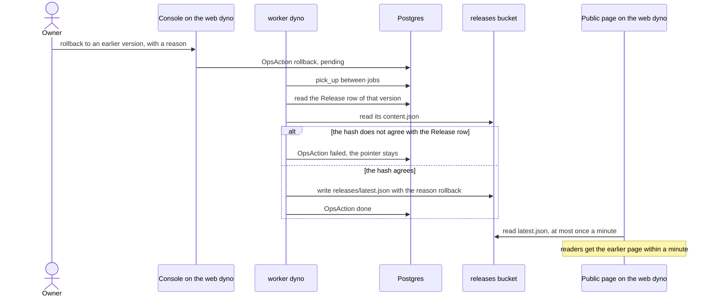

# Architecture

Purpose: This file shows the system in six diagrams and tells what each diagram shows.

The diagrams use Mermaid. GitHub and the console Docs page draw them as pictures. The names in the diagrams are the
names in the code.

## Context

The context diagram shows the people, the agents and the outside systems that connect to the platform.

- The owner is the one person who maintains and operates the system.
- Jobs read the outside sources. Each request goes through one HTTP client, `ingest.http.Fetcher`. The Fetcher
  refuses a host that the source policy does not permit.
- Agents use the agent API only. Agents read each cited page themselves. A `browser_only` site gets a browser.
- The job `prefetch_sources` reads the `allowed` pages of the queued tasks first. Agents read the stored text of
  these pages through the agent API. The text stays private and goes away after the retention time (ADR 0036).
- A reviewer is a separate Claude session that writes nothing to the database. The reviewer gives a review and an
  edit file to the owner.
- Readers get the public page only. The page does not read the database.
- If the owner sets `ALERT_EMAILS` and the mail config vars, the system sends one email after a job fails three runs
  in a row. Without them, the alert is only a log line.

## Components

The component diagram shows the processes, the stores and the outside services, and which component reads or writes
which store.

| Component | What it does |
|---|---|
| `web` dyno | It runs gunicorn. It serves the public page, the admin, the console, the agent API and `/healthz`. |
| The public page, `/` | It reads `releases/latest.json` at most once a minute. It serves the `timeline.html` of that release from memory. |
| `worker` dyno | It runs `manage.py run_jobs --loop`. Each `WORKER_TICK_SECONDS` (60), it runs the jobs that are due. |
| Console actions in the worker | Between jobs, the worker runs the console actions that wait as `pending`: a job run, a publish check, a publish, a rollback. |
| One-off dyno | `heroku run` starts it for one command, for example `manage.py publish` or `manage.py apply_edits`. |
| Release phase | Before each deploy goes live, Heroku runs `manage.py migrate`. If a migration fails, the deploy stops. |
| Heroku Postgres | The database: all content, evidence, Revisions, the queue and the state of the jobs. |
| The `raw` bucket | Fetched documents, by content hash, at `raw/<hash[:2]>/<hash>`. The system writes each object one time. |
| The `releases` bucket | The release files and the pointer. The pointer is the only object that the system writes again. |
| GitHub and CI | CI runs `make check-pr` on each pull request and on each push to `main`. |

> **NOTE:** The worker holds the scheduler lock for its life. If two workers run at the same time, the second worker
> waits. Thus a deploy never runs the jobs two times.

## Data flow

The data-flow diagram shows how an outside item becomes a part of the public page.

```mermaid
flowchart LR
    src["Source<br/>Publisher and Feed"] -- "a job fetches" --> doc["Document<br/>raw bytes in the raw bucket"]
    doc -- "entities and branch scores" --> cand["Candidate"]
    cand -- "process: cluster, priority at or above<br/>the threshold, under the daily cap" --> task["AgentTask<br/>write_event"]
    canon["Canonical rows<br/>Entry, Claim, Evidence, Revision"] -- "gap_waves, facts_sweep,<br/>second_source, branches_review" --> task2["AgentTask<br/>fill_gap, verify_claim,<br/>review_branch_proposal"]
    task & task2 -- "an agent claims it<br/>over the agent API" --> draft["Agent draft<br/>new entries with status review,<br/>evidence, accepted proposals"]
    draft -- "a reviewer reads, GET only" --> review["Review<br/>var/reviews/name.md"]
    review --> edits["Edit file<br/>var/reviews/name.edits.json"]
    edits -- "apply_edits as human:owner<br/>approve sets status published" --> canon
    canon -- "manage.py publish<br/>and the release gates" --> release["Release<br/>releases/version/ files,<br/>Release row, latest.json"]
    release -- "the web dyno reads<br/>the pointer" --> pagenode["Public page"]
```

1. A job fetches an item from a source. The job writes a `Document` row and puts the raw bytes in the `raw` bucket.
2. The job finds the Wikidata items in the document and makes a `Candidate`.
3. The `process` job groups the candidates by story. A story with a priority at or above `WRITE_EVENT_THRESHOLD`
   (70) becomes a `write_event` task. The daily cap `WRITE_EVENT_TASKS_PER_DAY` (20) limits the new tasks.
4. Other jobs read the canonical rows and make other tasks. `gap_waves` makes `fill_gap` tasks under the cap
   `FILL_GAP_TASKS_PER_DAY` (40).
5. An agent claims a task and completes it. The API writes the result through the service layer as
   `agent:<name>`. A new entry gets the status `review`.
6. A reviewer reads the drafts and writes a review and an edit file. The owner applies the edit file.
7. `manage.py publish` exports only the entries that have the status `published`. It writes a release.
8. The `web` dyno serves the page of the release that `releases/latest.json` names.

## Deployment

The deployment diagram shows where each part runs, the DNS names and the storage buckets.

| Item | Value |
|---|---|
| Heroku app | `humanitributary-staging`, in the pipeline `humanitributary`. It holds the live data. |
| Dynos | `web` and `worker`, one Basic dyno each, as `app.json` states. `heroku ps -a humanitributary-staging` shows the real count. |
| Database | Heroku Postgres Essential-1, Postgres 16, as `DATABASE_URL`, with TLS. Heroku keeps a backup each day. |
| Object storage | AWS S3 in us-east-1: `humanitributary-staging-raw` and `humanitributary-staging-releases`. S3 blocks public access. |
| DNS | Cloudflare holds the two zones. Each `manyages.com` name is a CNAME to its Heroku DNS target, with DNS only (no proxy). |
| `data.manyages.com` | The admin, the console and the agent API |
| `manyages.com` | The public page. The app sends `www.manyages.com` to this name. |
| `humanitributary.com` | The old name of the site. Cloudflare sends `humanitributary.com` and `www.humanitributary.com` to `https://manyages.com`, with the same path and query (301). The domain expires on November 26, 2027. |
| `data.humanitributary.com` | The old data host. It serves the admin, the console and the agent API until all agent environments use `data.manyages.com`. |
| Deploys | Heroku deploys `main` automatically after CI passes on it. |

> **NOTE:** The public page and the data host are the same app. `OPS_HOSTS` can limit the console to the data host.

## Sequence: one agent round

This diagram shows one agent that does one task, and then the review of the drafts. The daily round does all of
it through the agent API: see [the daily round](daily-round.md).

1. The owner starts an agent session. The session has a skill and an agent token.
2. The agent claims a task. `SKIP LOCKED` makes sure that two agents never get the same task.
3. The agent reads the payload, the related entries and each cited page.
4. If the work takes more than 30 minutes, the agent extends the lease.
5. The agent completes the task. If the result does not match the schema of its kind, the API returns 422. The task
   stays with the agent.
6. If the result is valid, the API applies it and completes the task in one transaction. Each change has a
   `Revision` that names the task.
7. A reviewer reads the drafts and the cited pages, and writes an edit file. The owner applies it.

## Sequence: publish

This diagram shows a publish from the console. `heroku run python manage.py publish` does the same steps in a
one-off dyno.

1. The owner starts `publish_check`. It writes nothing. The worker does the release gates and makes the change
   report.
2. The owner reads the change report and starts `publish` with a reason. The check must be 30 minutes old or less.
3. The worker compares the content hash and the page hash with the check. If they changed, the publish stops.
4. The worker does the release gates again. It writes the release files, then the `Release` row, then the pointer.
5. Within one minute, the `web` dyno reads the new pointer and serves the new page.

## Sequence: rollback

This diagram shows a rollback from the console. `heroku run python manage.py publish --rollback <version>` does the
same steps in a one-off dyno.

- A rollback writes only the pointer. It does not delete a release, and it does not change the database.
- The next publish compares the database with the newest `Release` row, not with the pointer.
