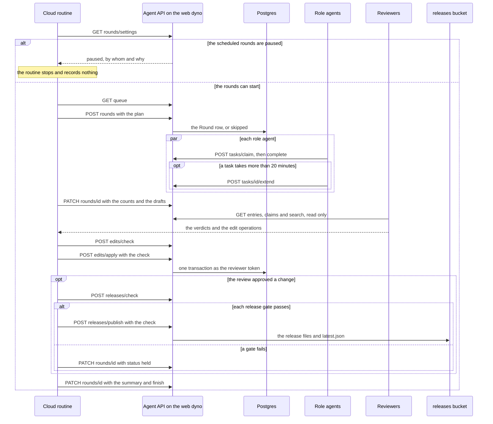

# The daily round

Purpose: This page tells what the daily agent round does, what it needs, and what the owner controls.

## What the daily round does

Each day a Claude Code cloud routine starts one agent round. The routine follows the skill `run-round`. It uses
only the agent API. It does not use a shell on the Heroku app, and it does not use the database directly.

A round has five stages:

1. **Plan.** The routine reads the round configuration and the queue. It selects the tasks of most value.
2. **Agents.** Role agents do the tasks: gap fillers first, then mappers, writers and verifiers.
3. **Review.** New reviewers read each draft and each page that it cites. They write one edit file.
4. **Apply.** The API examines the edit file, then applies it in one transaction.
5. **Publish.** If the review approved a change and each release gate passes, the API publishes a release.

The owner approved this policy (ADR 0035). A draft that a reviewer holds or rejects never goes into a release.

## The sequence

1. The routine reads the round configuration first. If an operator paused the scheduled rounds, the routine stops.
2. The routine reads the queue and makes a plan. The round configuration gives the number of agents and tasks.
3. `POST rounds` records the round. If an operator asked to skip it, the API records a skipped round.
4. Each role agent claims tasks, one at a time, and completes them. It extends a lease after 20 minutes.
5. Reviewers that did not write the drafts read them. They read each cited page again.
6. `edits/check` makes a dry run of the edit file. `edits/apply` applies the same operations in one transaction.
7. `releases/check` does the release gates. If they pass, `releases/publish` writes the release.
8. The routine records the result and writes a short summary.

## The tokens

The routine has one agent token for each role. The owner makes each token with `manage.py agent_token create`. The
owner keeps them as secrets of the cloud environment. Procedure [15](procedures/15-set-up-the-daily-round.md) tells
how.

| Secret | Token name | Scope | Use |
|---|---|---|---|
| `HUMANITRIBUTARY_TOKEN_ROUND` | `round-recorder` | `round` | It records the round. |
| `HUMANITRIBUTARY_TOKEN_WRITER` | `round-writer` | `write_event` | The writers |
| `HUMANITRIBUTARY_TOKEN_FILLER` | `round-filler` | `fill_gap` | The gap fillers |
| `HUMANITRIBUTARY_TOKEN_VERIFIER` | `round-verifier` | `verify_claim` | The verifiers |
| `HUMANITRIBUTARY_TOKEN_MAPPER` | `round-mapper` | `map_branch_entities` | The mappers |
| `HUMANITRIBUTARY_TOKEN_REVIEWER` | `round-reviewer` | `review` | It examines and applies the edit file. |
| `HUMANITRIBUTARY_TOKEN_PUBLISHER` | `round-publisher` | `publish` | It does the release gates and publishes. |

The scope `*` does not give `review`, `publish` or `round`. The owner must name each of these scopes.

> **CAUTION:** Do not put a token in a URL, in a log or in a file that git tracks. If another person gets a token,
> revoke it with procedure [09](procedures/09-replace-an-agent-token.md).

## The cloud session has no browser

A cloud session has no in-app browser. Thus the agents cannot read the `browser_only` publishers, for example
Britannica, BBC, the Guardian, NPR, AP, Al Jazeera and un.org. The agents never get these pages with a script. They
use other reputable sources. If a draft has support only from a `browser_only` page, the reviewer holds it. Then
you can examine it in a browser with procedure [01](procedures/01-run-a-round-by-hand.md).

The job `prefetch_sources` reads the `allowed` pages of each task before the round (ADR 0036). The agents and the
reviewers read the stored text of these pages through the agent API, and copy their excerpts from it. The API
refuses an excerpt that is not on a stored page. The list `unreadable` in each task tells the agents which pages
need a browser: the reasons `browser_only`, `citation_only` and `ai_blocked`.

Before an agent reads a page with a script, it asks the API: `GET /api/agent/policy?url=<url>` (ADR 0042). The agent
reads the page only if the answer has `may_fetch: true`. The answer is false for `browser_only`, `citation_only`,
`forbidden` and unrated sites, and for sites that block AI crawlers. Then the agent uses a different source. If no
different source is possible, the agent releases the task with `needs: browser`.

The summary of the round lists each such task on the line "Needs the owner". Do procedure
[18](procedures/18-do-a-task-that-needs-a-browser.md) for each.

A release puts the task back in the queue, but agents do not get it again for 60 minutes. A release with a need
waits 7 days. Thus the agents of a round do not claim the same task again and again.

## What the owner controls

The Work page of the console shows the round schedule, the last round and the last ten rounds. An operator can do
these actions there. Procedure [14](procedures/14-control-the-daily-round.md) gives the steps.

| Action | Result |
|---|---|
| Pause rounds | The routine starts on its schedule, reads the configuration and stops. A round that you start by hand still runs. |
| Resume rounds | The next scheduled round runs. |
| Skip the next | The API records the next scheduled round as skipped. The round after it runs. |
| Set the round size | The next round uses the new number of agents and tasks for each role. |
| Send held drafts to the next review | The reviewers of the next round read these drafts again. |

The console never starts a round and never connects to Anthropic. It changes only the configuration that the routine
reads.

## Safety

- Each change that a round makes has a `Revision` with the name of the reviewer token. The reason names the round.
- Each call to `edits/apply` and `releases/publish` has an `OpsAction` row. The action log shows it.
- One publish or rollback at a time: the console and the API use the same lock.
- A reviewer cannot approve its own draft. An edit file from the API cannot add a published entry.
- If a release is bad, do a rollback with procedure [04](procedures/04-do-a-rollback.md).
