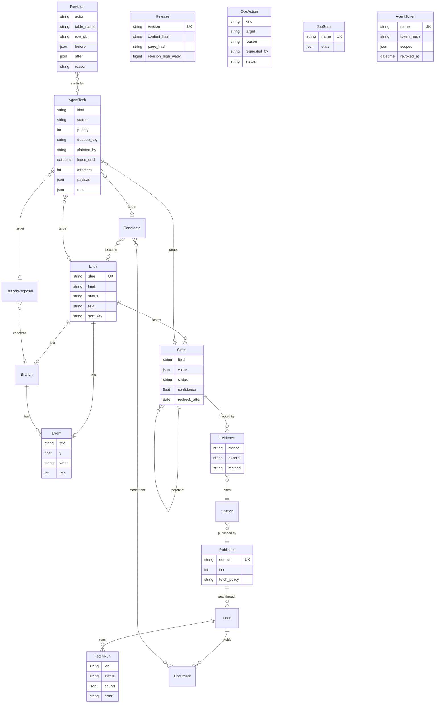
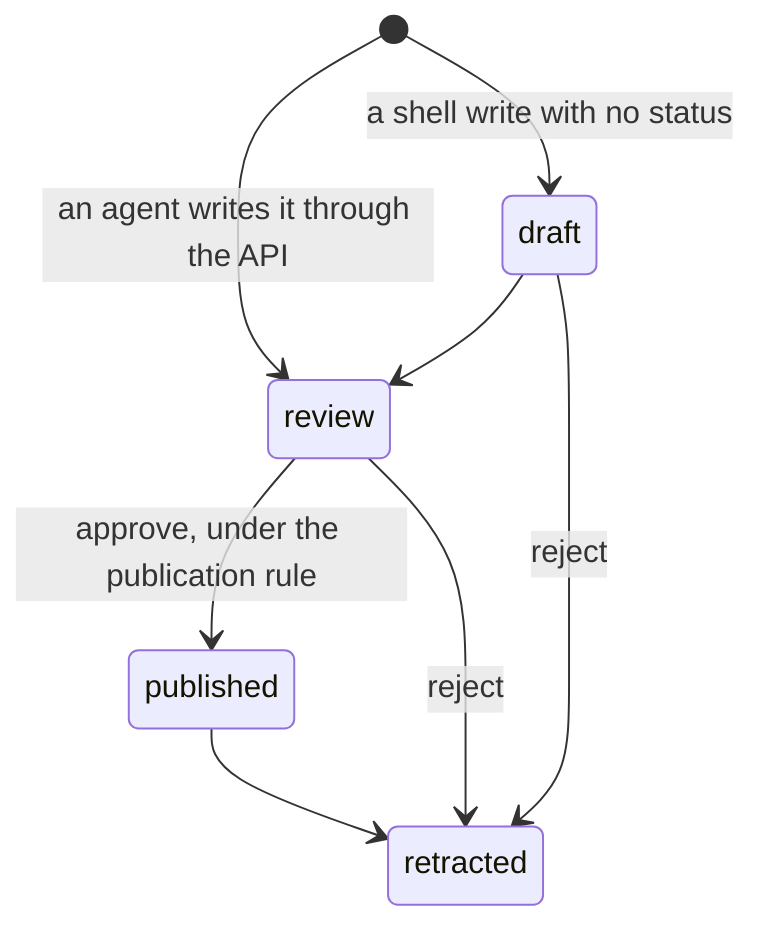

# Data model

Purpose: This file tells what the main tables hold and how they connect, in plain terms.

The database has more tables than this file shows. This file shows only the tables that a maintainer uses. The full
list is in `docs/data-model.md`.

## Two kinds of tables

- **Canonical tables** hold what the timeline says and its evidence. All tables in the apps `timeline` and
  `evidence` are canonical. A Postgres trigger accepts a write to them only inside `revisions.revising()`. Each
  changed row makes a `Revision` row.
- **Operational tables** hold the state of the machinery: the queue, the jobs, the releases and the console actions.
  They have no trigger and no `Revision` rows.

> **WARNING:** Do not write to a canonical table with raw SQL, and do not disable the trigger. If you do, the change
> has no history, and the `Revision` log is not complete.

## The diagram

`Release`, `OpsAction`, `JobState` and `AgentToken` have no foreign keys. `Release.revision_high_water` is the id of
the last `Revision` that the release includes. It is a number, not a foreign key.

## The tables

| Table | Kind | What it holds |
|---|---|---|
| `Entry` | canonical | Each item on the timeline. The `slug` is unique across branches and events. The `status` is `draft`, `review`, `published` or `retracted`. |
| `Branch` | canonical | A line on the timeline, for example a state or a faith. It extends `Entry`. |
| `Event` | canonical | A moment or a period on a branch. It extends `Entry`. `imp` is 1 (a landmark), 2 or 3 (a detail). |
| `Claim` | canonical | One statement about an entry. The system calculates its `status` and `confidence`. Nobody types them. |
| `Evidence` | canonical | One citation for one claim, with a stance (`supports`, `partial`, `conflicts` or `unrelated`) and an excerpt of 25 words or fewer. |
| `Citation` | canonical | One cited URL, with the result of its last check |
| `Publisher` | canonical | A cited site, by domain, with a `tier` from 1 to 4 and a `fetch_policy` (`allowed`, `browser_only` or `forbidden`) |
| `Revision` | audit log | One changed canonical row: who, why, which task, and the row before and after. The trigger writes it. Nobody edits it. |
| `Feed` | operational | A source that a job reads on a schedule, with its interval and an on or off value (`enabled`) |
| `FetchRun` | operational | One run of one job, with its status, counts and error |
| `Document` | operational | A fetched page. Its raw bytes are in the `raw` bucket under the content hash. |
| `Candidate` | operational | A possible event from one or more documents, with its cluster and priority |
| `AgentTask` | operational | One task in the queue. Its `status` is `queued`, `claimed`, `done`, `failed` or `cancelled`. |
| `BranchProposal` | operational | A rule's proposal to split, merge, end or add a branch |
| `AgentToken` | operational | The hash of an agent token, its scopes, its last use and its revocation time |
| `Release` | operational | One release: its version, the two hashes and the counts. The pointer, not this table, names the live release. |
| `OpsAction` | operational | The audit row of each console action: who, what, why, the status and the result |
| `JobState` | operational | Bookmarks for jobs, the active content wave, and the list of paused jobs ("paused_jobs") |

## The status of an entry

- A new entry from the agent API has the status `review`.
- Only an entry with the status `published` goes into a release.
- The `approve` operation of an edit file and `manage.py facts publish` obey the publication rule. The rule refuses a
  contested claim that the text does not flag. It also refuses an event that has no source other than Wikipedia,
  after a grace time of 14 days for current events.
- A retracted entry stays in the database. It does not go into a release.
