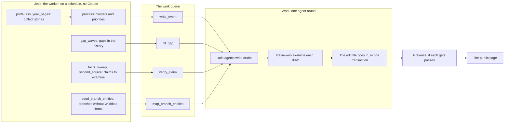

# How Jobs and Work fit together

Purpose: This page tells the difference between the Jobs tab and the Work tab of the console, and how they connect.

## Two kinds of work

**Jobs** are programs that the worker dyno runs on a schedule. They collect and prepare material and make tasks.
They do not use Claude. The same input always gives the same output.

**Work** is the tasks that Claude agents do in rounds. Each round writes drafts, a reviewer examines them, and the
approved changes go into a release.

## The flow

## Where to look in the console

| Tab | What it shows | Links to the other tab |
|---|---|---|
| Jobs | Each job, its schedule, its last ten runs and its next run | A job names the task kinds that it makes. |
| Work | The round schedule, the last ten rounds and a card for each task kind | A card names the jobs that make its tasks. |

## Which page to use

- If a job fails, use procedure [05](procedures/05-run-a-failed-job-again.md).
- If a job must stop for a time, use procedure [06](procedures/06-pause-and-resume-a-job.md).
- If a task stays in progress after its agent stops, use procedure [07](procedures/07-release-a-stuck-task.md).
- If the rounds must stop, skip a day or change size, use procedure [14](procedures/14-control-the-daily-round.md).
- For the stages of a round, read [the daily round](daily-round.md).
